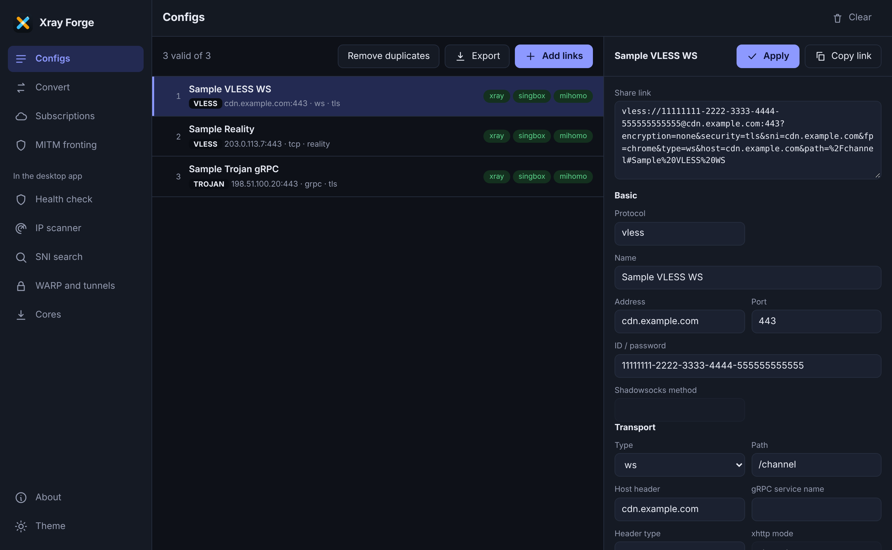
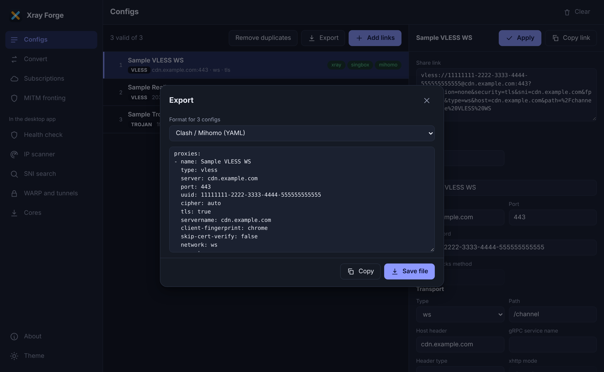
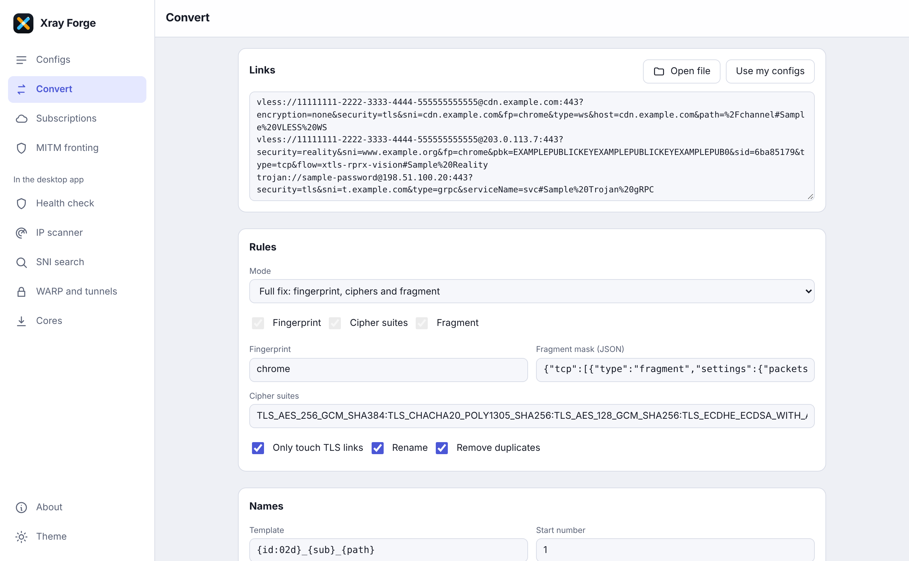
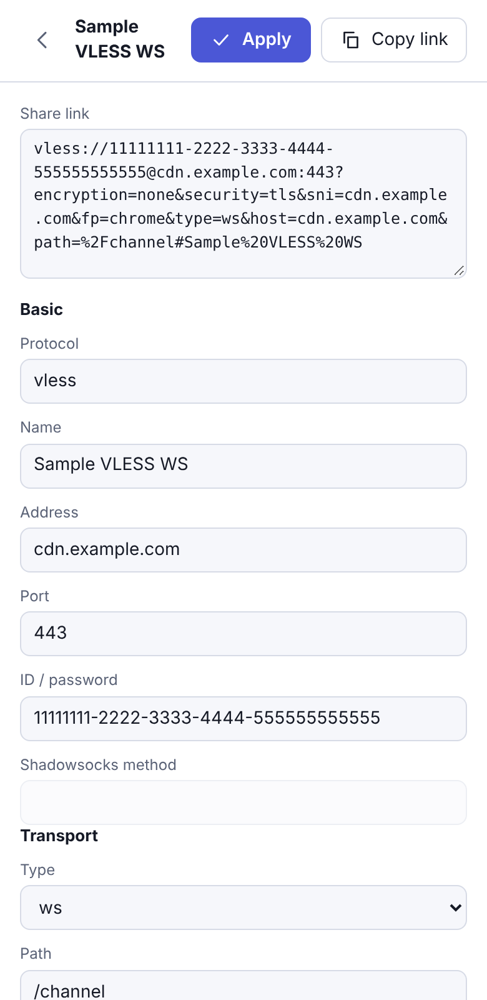
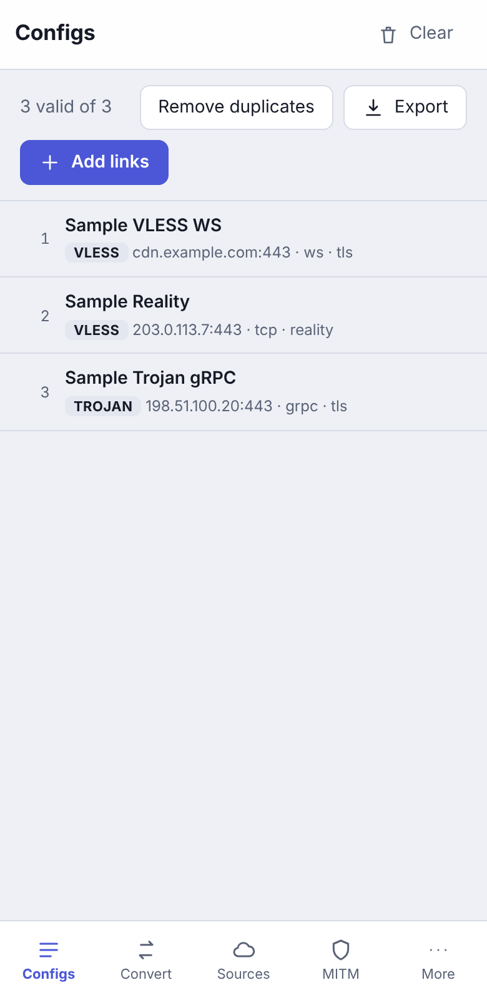
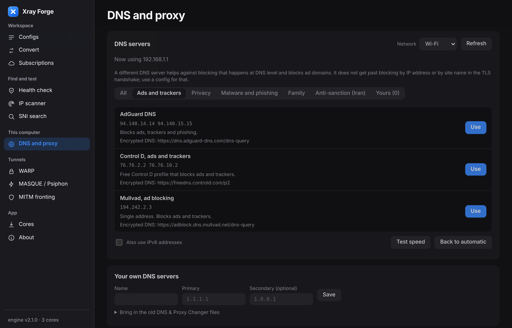

# ⚡ Xray Forge (Modular Edition)

[](https://github.com/rezaxr14/Xray_Forge/actions/workflows/ci.yml)
[](https://github.com/rezaxr14/Xray_Forge/actions/workflows/pages.yml)

**Try it without installing anything: <https://rezaxr14.github.io/Xray_Forge/>** (works offline once opened, and can be installed from the browser like an app).

<p align="center">
  
</p>

A full-featured, modular Python utility for managing, fixing, testing, and exporting **VLESS / VMess / Trojan / Shadowsocks / Hysteria2 / TUIC / WireGuard-WARP** proxy configurations — with DPI-resistant probing, real core integration (Xray-core / sing-box / Mihomo), exit-country analytics, resumable IP scanning, a staged subscription health-check pipeline, and multi-format export.

> 🇮🇷 Designed with anti-DPI and censorship-resistance in mind: fragmented ClientHello probes, fake SNI, domain fronting, a local MITM-DomainFronting generator, DoH-over-IP DNS, and real-tunnel exit-IP detection.

---

## 🌐 Web app (no install)

The same config engine, ported to dependency-free JavaScript, runs entirely in your browser. Nothing is uploaded; there is no server, account or database. It is a PWA: it works offline after the first visit and can be installed from the browser menu on desktop and phones.

| Dark, desktop | Light, desktop | Phone |
|---|---|---|
|  |  |   |

**Works in the browser:** parse and edit links, bulk convert (fingerprint, cipher suites, fragment, naming, endpoint override), de-duplication, export to Clash / Mihomo, sing-box and base64 subscriptions, plain and base64 subscriptions (from a URL the server allows, or pasted), and the MITM-fronting config and guide.

**Needs the desktop app:** health checks, IP and SNI scanners, WARP / MASQUE / Psiphon and core management. Browsers cannot start programs or open raw sockets, so these screens say so instead of pretending.

The JavaScript engine reproduces the Python engine's output (checked in `web/test/engine.test.mjs`). Details and known differences: [docs/web-app.md](docs/web-app.md).

```bash
cd web && npm test && npm run build   # Node 22+, no dependencies; output in web/dist
```

---

## 📦 Project Structure

```
Xray_Forge/
├── Xray_Forge.py             # root launcher (CLI) → xray_forge.cli:main
├── electron/                 # desktop app (Electron UI over the engine, JSON-RPC on stdio)
├── web/                      # browser app (GitHub Pages): JS port of the config engine + PWA UI
├── AGENTS.md                 # instructions for AI agents / contributors
├── ROADMAP.md                # phased plan + status
├── pyproject.toml            # pip-installable package config (py ≥ 3.10)
├── requirements.txt          # dependencies (curl_cffi, PyYAML)
├── .github/workflows/        # ci.yml (test matrix) · release.yml (exe builds)
└── xray_forge/               # Modular Python package
    ├── __main__.py           # Entry point: `python -m xray_forge`
    ├── cli.py                # Headless CLI (subcommands)
    ├── engine/               # JSON-RPC engine API used by the desktop app (`serve`)
    ├── core/
    │   ├── models.py         # Outbound dataclass — the config representation
    │   ├── config.py         # Constants, fingerprints, ranges, presets
    │   ├── parser.py         # URI fixing, naming engine, exporters (Clash/Sing-box/sub)
    │   ├── protocols/        # Protocol registry: vless, vmess, trojan, ss,
    │   │                     #   hysteria2, tuic, wireguard (+ share-link builders)
    │   ├── cores/            # Core adapters: Xray-core, sing-box, Mihomo
    │   ├── xray_bridge.py    # Backwards-compatible Xray bridge
    │   ├── probe.py          # DPI-resistant TLS, WebSocket, VLESS tunnel, DoH
    │   ├── socks.py          # SOCKS5 client + HTTP-through-socks
    │   ├── scanner.py        # DNS resolution, GeoIP, CIDR sampling, jitter
    │   ├── scan_session.py   # Resumable scan sessions (CSV/JSON, per-ISP)
    │   ├── sni_search.py    # SNI / fronting-host search (candidates × clean IPs)
    │   ├── subscription.py   # Sub fetch + multi-format decode (b64/Clash/sing-box)
    │   ├── sub_source.py     # Subscription source manager (ETag cache, dedup)
    │   ├── healthcheck.py    # Staged pipeline: dns→tcp→tls→request→throughput
    │   ├── domainfront.py    # MITM-DomainFronting config generator + CA tools
    │   ├── warp.py           # WARP accounts, X25519, endpoint scanning
    │   ├── settings.py       # Settings + per-user data dir (~/.xray_forge)
    │   └── dedup.py          # Config deduplication
```

---

## 🚀 Installation

```bash
# Clone or extract, then:
pip install -r requirements.txt

# Use the CLI
python -m xray_forge --help

# Desktop app (Electron; needs Node 22+)
cd electron && npm install && npm start
```

Install as a package (adds the `xray-forge` command):

```bash
pip install .
xray-forge --help
```

Optional extras:

```bash
pip install ".[mitm]"     # cryptography, for MITM-DomainFronting CA generation
```

---

## 🖥️ Desktop app

The UI is an Electron app (`electron/`) that talks to the Python engine
(`python -m xray_forge serve`, see `docs/engine-api.md`); release builds bundle
the engine. The old Tkinter GUI has been retired.

| Tab | Purpose |
|-----|---------|
| **Configs** | Paste or open links → table with the editor (Reality, XHTTP, headers, raw JSON round-trip), dedup, export to Clash / sing-box / subscription |
| **Convert** | Live rules: fingerprint / cipher / fragment injection, renaming templates, forced IP / port, duplicate removal |
| **Health** | Staged checks with scoring, technique tags, `[CC]` exit-country tags, retest selected rows |
| **Subscriptions** | Source manager, check all sources, best-N export, tagged lines |
| **IP scanner** | Geo / DNS lookup, resumable CIDR scans (range presets, fragment spec), CSV/JSON export |
| **SNI search** | (ip, sni) pairs your network lets through |
| **DNS and proxy** | Pick a public DNS (ad blocking, privacy, malware filtering, family, Iranian anti-sanction), test which is fastest, apply it to a network adapter or reset it; set or clear the system proxy; saved entries; import from the old Network-Config-Utility |
| **WARP · MITM · Cores** | WARP device and config, MITM-DomainFronting generator, proxy-core detection |

The desktop app uses an Apple-style layout: translucent sidebar, grouped cards, light and dark themes that follow the system.



**DNS and proxy.** Changing system DNS and proxy works on Windows (PowerShell, registry), macOS (`networksetup`)
and Linux (`resolvectl`, GNOME `gsettings`) and needs administrator or root rights. It helps against
DNS-level blocking and ads. It does not get past blocking by IP address or by site name in the TLS handshake. Also from the CLI:

```bash
python -m xray_forge dns list
python -m xray_forge dns test --preset cloudflare --preset adguard
python -m xray_forge dns apply --interface "Wi-Fi" --preset adguard
python -m xray_forge dns reset --interface "Wi-Fi"
python -m xray_forge proxy set --host 127.0.0.1 --port 10808 --kind socks
```

The iranian entries (Shecan, Electro, Begzar, Radar, 403) come from public lists; 403 is marked unverified. Check them yourself.

### 5. Real Core Bridge (probe through actual engines)
- Auto-detects `xray` from v2rayN, PATH, env `XRAY_CORE`
- Generic SOCKS probe runner shared by Xray / sing-box / Mihomo adapters
- Spawns the real engine, tests through its local SOCKS, reports exit IP + country

### 6. IP Finder & Scanner (resumable sessions)
- CIDR sampling (Cloudflare **and Fastly** ranges built in) with configurable count/workers
- Latency **and jitter** measurement; SNI modes: config SNI / no SNI / custom
- **Scan sessions** persist to `~/.xray_forge/scans/` — stop and resume later, even from a new process
- CSV/JSON export and per-ISP grouping for comparing scans over time
- Anti-hijack DNS: DoH (1.1.1.1, 8.8.8.8, shecan, 403) + Iranian UDP resolvers + system DNS
- One-click "use as FORCE IP" from scan results (desktop app)

### 7. Subscription Pipeline (test on YOUR network)
- **Source manager:** any number of subscription URLs with ETag-based caching, auto-detection of base64 / plain text / **Clash YAML** / **sing-box JSON**, and de-duplication across sources
- **Staged health checks:** DNS (DoH) → TCP (latency + jitter) → TLS with **fragmentation variants** (the working variant is tagged) → real request through the tunnel → **download + upload throughput**; protocols the native tunnel can't run (trojan, vmess, hysteria2, tuic, wireguard…) are checked through a locally spawned core (`--core auto`)
- Why throughput: many Iranian networks throttle upload to foreign IPs — a config that passes a latency check can still be unusable; testing runs locally, on your own connection
- **Ranking & output:** 0–100 score per config, best-N base64 subscription export, technique-tagged names (`name [fragment:5,94,1@2]`)

### 8. WireGuard / WARP
- Device registration via Cloudflare's client API (pure-python RFC 7748 X25519 — no heavy crypto dependency)
- Config generation for Xray / sing-box / Mihomo (incl. the WARP `reserved` field)
- Heuristic WARP endpoint scanning (UDP reachability across known ranges/ports)

### 9. Multi-Format Export
- **Clash Meta (Mihomo) YAML** — proxies section ready for Clash/Mihomo, with correct Reality options
- **Sing-box JSON** — outbounds with TLS/uTLS/Reality/transport
- **Base64 subscription** — standard `sub://` compatible link

### 10. Deduplication · Filtering · Best-Config Marking · Settings Persistence
- Duplicate removal (scheme + credential + host + port); the desktop app remembers its form values between runs

---

## 🧪 Development

```bash
pip install -r requirements.txt -r <(echo pytest; echo ruff)   # or: pip install ".[dev]"
python -m pytest tests -q          # 107 offline tests (network probes monkeypatched)
ruff check --select E9,F63,F7,F82 .
```

See [`AGENTS.md`](AGENTS.md) for the full contributor/agent handbook and
[`ROADMAP.md`](ROADMAP.md) for the phased plan and current status.

Releases are built automatically: pushing a `v*` tag runs the test suite and builds, on
Windows and Linux, the desktop app (installer / AppImage) and the single-file command-line
executable, then attaches them (with SHA-256 checksums) to a GitHub Release. The Windows installer
is unsigned (SmartScreen will warn); see [`docs/packaging.md`](docs/packaging.md).

---

## 📄 License

Xray Forge is free software, licensed under the **GNU General Public License, version 3**
(`GPL-3.0-only`).

You may use, study, modify and share it, including commercially, as long as anything you
distribute (modified or not, source or binary) stays under the same license, comes with its
source code, and keeps the copyright and license notices ([`NOTICE`](NOTICE)). There is no
warranty. The proxy cores the app can launch (Xray-core, sing-box, mihomo, Psiphon, ...) are
separate programs with their own licenses.

See [`LICENSE`](LICENSE) for the full legal text.

---

## ⚠️ Disclaimer

This tool is for educational and network-diagnostic purposes. Users are responsible for complying with their local laws and regulations regarding proxy/circumvention software. The authors are not responsible for any misuse.

## Electron UI (preview)

The new front end lives in `electron/` and drives the Python engine over
stdio (`python -m xray_forge serve`, protocol in `docs/engine-api.md`).

```bash
cd electron
npm install
npm start          # needs python3 with this package's requirements on PATH
npm test           # Playwright e2e (npm i --no-save playwright first)
```

Set `XRAY_FORGE_PYTHON` to use a specific interpreter.
