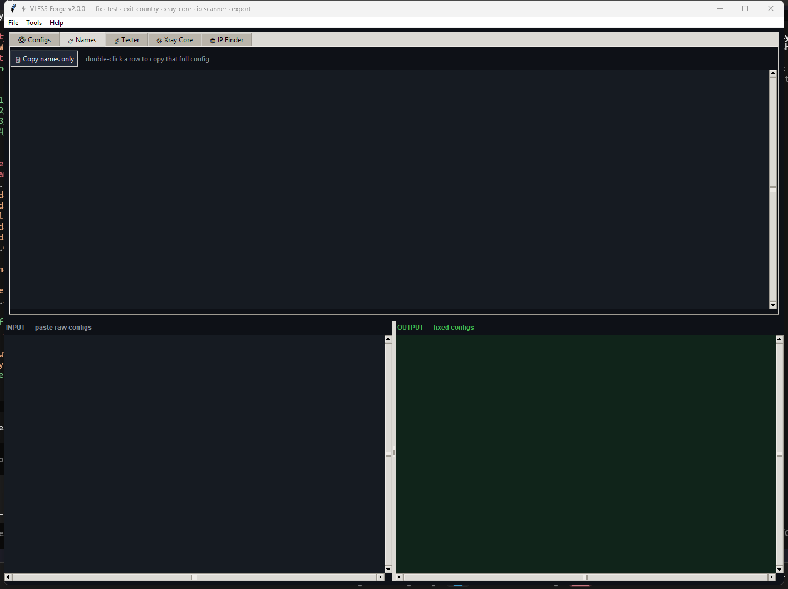
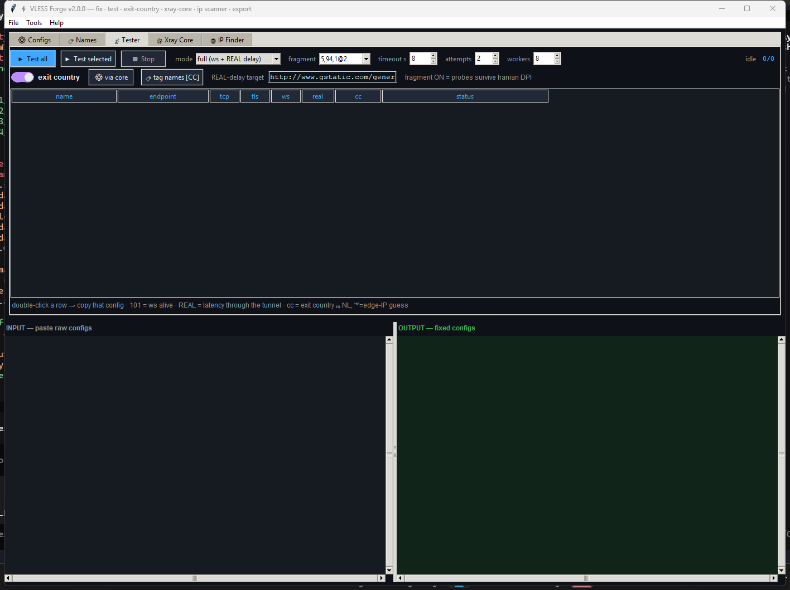
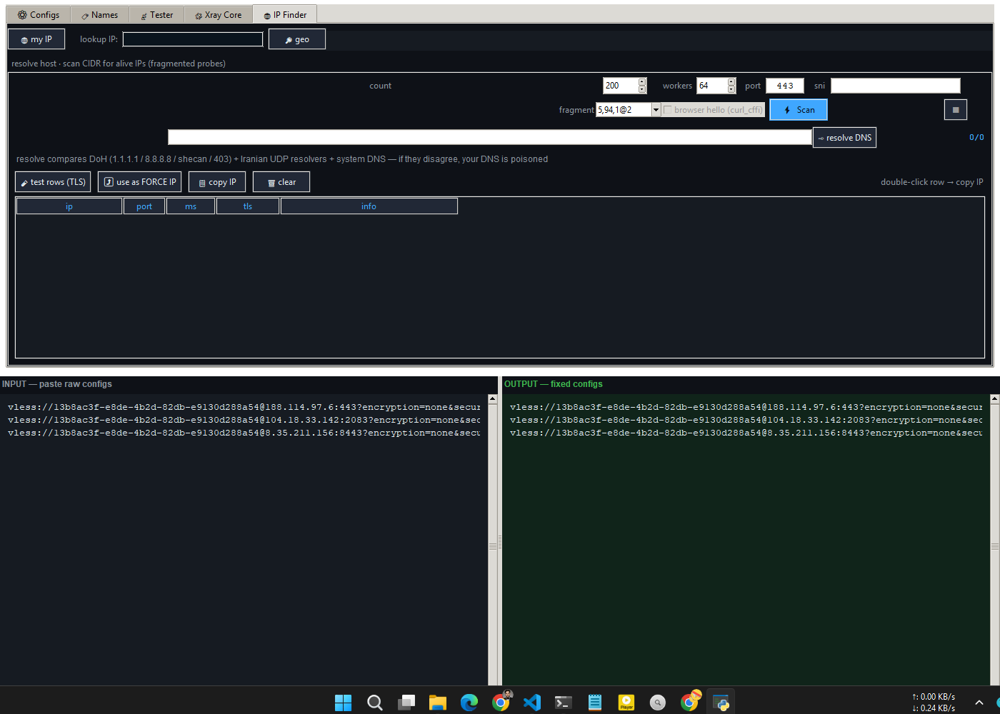

# ⚡ Xray Forge (Modular Edition)

[](https://github.com/rezaxr14/Xray_Forge/actions/workflows/ci.yml)

A full-featured, modular Python utility for managing, fixing, testing, and exporting **VLESS / VMess / Trojan / Shadowsocks / Hysteria2 / TUIC / WireGuard-WARP** proxy configurations — with DPI-resistant probing, real core integration (Xray-core / sing-box / Mihomo), exit-country analytics, resumable IP scanning, a staged subscription health-check pipeline, and multi-format export.

> 🇮🇷 Designed with anti-DPI and censorship-resistance in mind: fragmented ClientHello probes, fake SNI, domain fronting, a local MITM-DomainFronting generator, DoH-over-IP DNS, and real-tunnel exit-IP detection.

---

## 📦 Project Structure

```
Xray_Forge/
├── Xray_Forge.py             # root launcher (CLI + GUI) → xray_forge.cli:main
├── AGENTS.md                 # instructions for AI agents / contributors
├── ROADMAP.md                # phased plan + status
├── pyproject.toml            # pip-installable package config (py ≥ 3.10)
├── requirements.txt          # dependencies (curl_cffi, PyYAML)
├── .github/workflows/        # ci.yml (test matrix) · release.yml (exe builds)
└── xray_forge/               # Modular Python package
    ├── __main__.py           # Entry point: `python -m xray_forge`
    ├── cli.py                # Headless CLI (subcommands; never imports tkinter)
    ├── app.py                # Tkinter GUI (App class)
    ├── core/
    │   ├── models.py         # Outbound dataclass — the config representation
    │   ├── config.py         # Constants, fingerprints, ranges, presets
    │   ├── parser.py         # URI fixing, naming engine, exporters (Clash/Sing-box/sub)
    │   ├── protocols/        # Protocol registry: vless, vmess, trojan, ss,
    │   │                     #   hysteria2, tuic, wireguard (+ share-link builders)
    │   ├── cores/            # Core adapters: Xray-core, sing-box, Mihomo
    │   ├── xray_bridge.py    # Backwards-compatible Xray bridge
    │   ├── probe.py          # DPI-resistant TLS, WebSocket, VLESS tunnel, DoH
    │   ├── socks.py          # SOCKS5 client + HTTP-through-socks
    │   ├── scanner.py        # DNS resolution, GeoIP, CIDR sampling, jitter
    │   ├── scan_session.py   # Resumable scan sessions (CSV/JSON, per-ISP)
    │   ├── sni_search.py    # SNI / fronting-host search (candidates × clean IPs)
    │   ├── subscription.py   # Sub fetch + multi-format decode (b64/Clash/sing-box)
    │   ├── sub_source.py     # Subscription source manager (ETag cache, dedup)
    │   ├── healthcheck.py    # Staged pipeline: dns→tcp→tls→request→throughput
    │   ├── domainfront.py    # MITM-DomainFronting config generator + CA tools
    │   ├── warp.py           # WARP accounts, X25519, endpoint scanning
    │   ├── settings.py       # Settings + per-user data dir (~/.xray_forge)
    │   ├── dedup.py          # Config deduplication
    │   └── prober_utils.py   # Shared formatting helpers
    └── ui/
        ├── widgets.py        # Tooltip, animated Switch toggle
        └── tabs/             # converter / tester / xray-core / ip-finder tabs
```

---

## 🚀 Installation

```bash
# Clone or extract, then:
pip install -r requirements.txt

# Run the GUI
python -m xray_forge gui

# Or use the CLI
python -m xray_forge --help
```

Install as a package (adds the `xray-forge` command):

```bash
pip install .
xray-forge --help
```

Optional extras:

```bash
pip install ".[mitm]"     # cryptography, for MITM-DomainFronting CA generation
```

---

## 🖥️ GUI Tabs

| Tab | Purpose |
|-----|---------|
| **⚙ Configs** | Paste raw configs → live-convert with fingerprint/cipher/fragment injection, renaming, and mass IP/port override |
| **✎ Editor** | Per-config field editor (Reality pbk/sid/spx, XHTTP mode, flow) + raw-JSON round-trip |
| **📡 Tester** | Fragmented TLS + WebSocket 101 + REAL delay through tunnel + exit-country detection |
| **🧩 Xray Core** | Auto-detect/verify `xray.exe` (v2rayN, PATH, etc.) and test configs through the real engine via local SOCKS |
| **🌐 IP Finder** | Geo lookup, anti-hijack DNS resolution (DoH + Iranian UDP + system), resumable CIDR scan sessions with CSV/JSON export |
| **🎯 SNI Search** | Probe candidate SNIs (fronting hosts) against clean IPs — find the (ip, sni) pairs your network lets through |
| **📥 Subscriptions** | Source manager (ETag cache) + staged health checks with scoring, technique tags, best-N subscription export |

## 📸 Screenshots

| Converter (fix · rename · mass override) | Tester (fragmented TLS · ws 101 · exit country) |
|---|---|
|  |  |
| Xray Core (real engine via local SOCKS) | IP Finder (geo · DNS resolve · CIDR scan) |
|  |  |

---

## 🔧 CLI Usage

The CLI is fully **headless** (no Tk required) and uses subcommands:

```bash
# Convert & fix configs (fingerprint + ciphers + fragment injection)
python -m xray_forge convert in.txt out.txt --fp chrome --ip 1.2.3.4 --port 443

# IP-only mode (no injection)
python -m xray_forge convert in.txt out.txt --ip-only

# Export
python -m xray_forge export in.txt clash.yaml   --format clash     # Clash Meta (Mihomo)
python -m xray_forge export in.txt singbox.json --format singbox   # Sing-box
python -m xray_forge export in.txt sub.txt      --format sub       # base64 subscription

# Test configs (native probes, or through a real xray binary)
python -m xray_forge test in.txt --frag 5,94,1@2
python -m xray_forge test in.txt --core /path/to/xray

# Resumable CIDR scan with jitter, CSV/JSON export and geo tagging
python -m xray_forge scan 104.16.0.0/13 --sni example.com --count 200 --geo \
       --csv scan.csv --json scan.json
python -m xray_forge scan 104.16.0.0/13 --resume scan_20250101_120000

# SNI / fronting-host search: candidate SNIs x clean IPs (from a scan session)
python -m xray_forge snisearch --from-scan scan_20250101_120000 \
       --presets --workers 32 --csv sni.csv --json sni.json

# Geo-lookup an IP
python -m xray_forge geo 1.1.1.1

# MITM-DomainFronting: generate the Xray config (+ optional personal CA + guide)
python -m xray_forge mitm -o MITM-DomainFronting.json --gen-cert --guide

# WARP: register a device, emit WireGuard outbounds, scan endpoints
python -m xray_forge warp register
python -m xray_forge warp config
python -m xray_forge warp scan-endpoints --count 100

# Subscription pipeline: manage sources, fetch, then health-check locally
python -m xray_forge subs add --url https://example.com/sub --name mylist
python -m xray_forge subs fetch
python -m xray_forge subs check --top 10 --out best.txt
python -m xray_forge subs check --core auto   # non-VLESS configs via a real core
```

### Subcommand options

| Command | Notable options |
|---------|-----------------|
| `convert` | `--fp --cs --fm --ip --port --template --start --no-rename --ip-only --no-fp --no-cs --no-fm --all-security --dedup` |
| `export` | `--format clash\|singbox\|sub` |
| `test` | `--timeout --frag --core` |
| `scan` | `--count --sni --port --workers --frag --resume NAME --csv FILE --json FILE --geo` |
| `snisearch` | `--ips --snis --presets --from-scan NAME --port --workers --frag --timeout --no-http --resume NAME --csv FILE --json FILE` |
| `geo` | `IP` (empty = your own IP) |
| `mitm` | `-o FILE --cn --gen-cert --groups google,meta,fastly --guide` |
| `warp` | `register\|config\|scan-endpoints` · `--endpoint --count --workers` |
| `subs` | `add\|list\|remove\|fetch\|check` · `--url --name --top --out --workers --timeout --no-throughput --core auto\|xray\|singbox\|mihomo` |

---

## ✨ Key Features

### 1. Config Conversion & Fixing
- **Three modes:** Full fix (fp + cs + fm), IP-only, Custom
- **Expanded uTLS fingerprints:** chrome, firefox, safari, edge, ios, android, opera, brave, vivaldi, qq, sogou, random, randomized, **unsafe**
- **Cipher suite injection** (`cs=`) with customizable lists
- **Fragment mask injection** (`fm=`) for DPI-resistant ClientHello
- **Smart naming engine** with template keys: `{id}`, `{sub}`, `{path}`, `{ip}`, `{port}`, `{host}`, `{net}`, `{sni}`, `{proto}`, `{old}`
- **Mass endpoint override** — force one IP:port on every config
- **Live auto-convert** as you type/paste

### 2. Protocols & Cores (registry-based)
- **Protocols:** VLESS (incl. **Reality** `pbk`/`sid`/`spx`, `flow`), VMess (base64 + plain), Trojan, Shadowsocks (SIP002 + legacy), Hysteria2, TUIC, WireGuard/WARP
- **Transports:** ws, grpc, httpupgrade, tcp, **xhttp**
- **Cores:** Xray-core, sing-box, Mihomo adapters build complete client configs; each reports exactly which protocols it can run (derived from the protocol renderers, so the UI/CLI only offer what the chosen core can execute)
- Share-link round-trips for every registered protocol (incl. Clash YAML ↔ URI and sing-box JSON ↔ URI)

### 3. DPI-Resistant Testing (heavy censorship)
- Fragmented ClientHello (same as `fm=` mask) — `5,94,1@2` / random presets
- **Fake / decoy Client Hello** with benign SNI (MMDF "instant certificate" style)
- **TLS record-layer fragmentation** — split SNI extension across records
- **Domain fronting** — connect to a front domain, request the real host inside the tunnel
- SNI case mixing, TLS padding, noise packets, TCP Fast Open, User-Agent rotation
- TCP ping + TLS handshake + WebSocket 101 upgrade
- REAL delay measurement through the tunnel
- Exit-country detection via geo APIs tunneled through the proxy
- Edge-IP country fallback (marked `*`)

### 4. MITM-DomainFronting (no VPS needed)
- `xray_forge mitm` generates an Xray-core ≥ 26.2.6 config implementing the documented technique: local TLS-terminating `tunnel` inbounds signed by a **personal** CA (`"usage": "issue"`), then re-packing requests to Google/Meta/Fastly services with a benign cover SNI (`fromMitM` verification)
- Optional per-user CA generation (`cryptography`) or the equivalent openssl command
- Built-in Windows / Android / Firefox setup guides (`--guide`)
- ⚠️ Never share your `mycert.key`, never use someone else's certificate

### 5. Real Core Bridge (probe through actual engines)
- Auto-detects `xray` from v2rayN, PATH, env `XRAY_CORE`
- Generic SOCKS probe runner shared by Xray / sing-box / Mihomo adapters
- Spawns the real engine, tests through its local SOCKS, reports exit IP + country

### 6. IP Finder & Scanner (resumable sessions)
- CIDR sampling (Cloudflare **and Fastly** ranges built in) with configurable count/workers
- Latency **and jitter** measurement; SNI modes: config SNI / no SNI / custom
- **Scan sessions** persist to `~/.xray_forge/scans/` — stop and resume later, even from a new process
- CSV/JSON export and per-ISP grouping for comparing scans over time
- Anti-hijack DNS: DoH (1.1.1.1, 8.8.8.8, shecan, 403) + Iranian UDP resolvers + system DNS
- One-click "use as FORCE IP" from scan results (GUI)

### 7. Subscription Pipeline (test on YOUR network)
- **Source manager:** any number of subscription URLs with ETag-based caching, auto-detection of base64 / plain text / **Clash YAML** / **sing-box JSON**, and de-duplication across sources
- **Staged health checks:** DNS (DoH) → TCP (latency + jitter) → TLS with **fragmentation variants** (the working variant is tagged) → real request through the tunnel → **download + upload throughput**; protocols the native tunnel can't run (trojan, vmess, hysteria2, tuic, wireguard…) are checked through a locally spawned core (`--core auto`)
- Why throughput: many Iranian networks throttle upload to foreign IPs — a config that passes a latency check can still be unusable; testing runs locally, on your own connection
- **Ranking & output:** 0–100 score per config, best-N base64 subscription export, technique-tagged names (`name [fragment:5,94,1@2]`)

### 8. WireGuard / WARP
- Device registration via Cloudflare's client API (pure-python RFC 7748 X25519 — no heavy crypto dependency)
- Config generation for Xray / sing-box / Mihomo (incl. the WARP `reserved` field)
- Heuristic WARP endpoint scanning (UDP reachability across known ranges/ports)

### 9. Multi-Format Export
- **Clash Meta (Mihomo) YAML** — proxies section ready for Clash/Mihomo, with correct Reality options
- **Sing-box JSON** — outbounds with TLS/uTLS/Reality/transport
- **Base64 subscription** — standard `sub://` compatible link

### 10. Deduplication · Filtering · Best-Config Marking · Settings Persistence
- Duplicate removal (scheme + credential + host + port), text filter, "★ mark best", full GUI state persistence

---

## 🧪 Development

```bash
pip install -r requirements.txt -r <(echo pytest; echo ruff)   # or: pip install ".[dev]"
python -m pytest tests -q          # 107 offline tests (network probes monkeypatched)
ruff check --select E9,F63,F7,F82 .
```

See [`AGENTS.md`](AGENTS.md) for the full contributor/agent handbook and
[`ROADMAP.md`](ROADMAP.md) for the phased plan and current status.

Releases are built automatically: pushing a `v*` tag runs the test suite,
builds Windows/Linux single-file executables with PyInstaller, and attaches
them (with SHA-256 checksums) to a GitHub Release.

---

## 📄 License

This project is licensed under the **Creative Commons Attribution 4.0 International (CC BY 4.0)**.

You are free to:
- **Share** — copy and redistribute the material in any medium or format
- **Adapt** — remix, transform, and build upon the material for any purpose, even commercially

As long as you give appropriate credit, provide a link to the license, and indicate if changes were made.

See [`LICENSE`](LICENSE) for the full legal text.

---

## ⚠️ Disclaimer

This tool is for educational and network-diagnostic purposes. Users are responsible for complying with their local laws and regulations regarding proxy/circumvention software. The authors are not responsible for any misuse.

## Electron UI (preview)

The new front end lives in `electron/` and drives the Python engine over
stdio (`python -m xray_forge serve`, protocol in `docs/engine-api.md`).

```bash
cd electron
npm install
npm start          # needs python3 with this package's requirements on PATH
npm test           # Playwright e2e (npm i --no-save playwright first)
```

Set `XRAY_FORGE_PYTHON` to use a specific interpreter.
